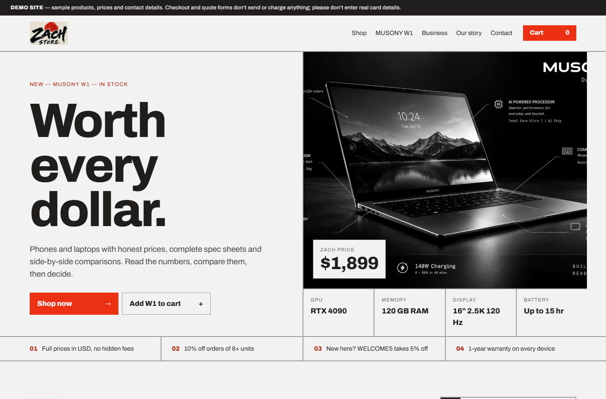
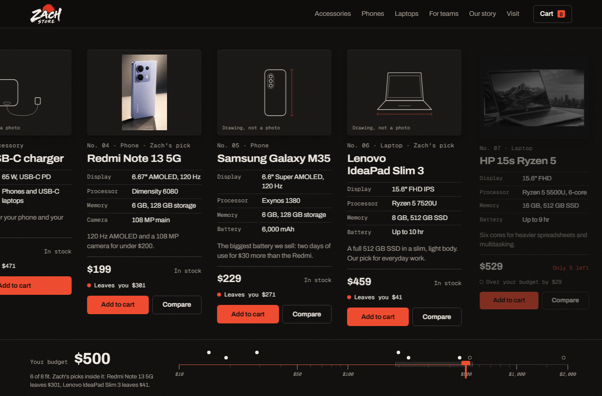
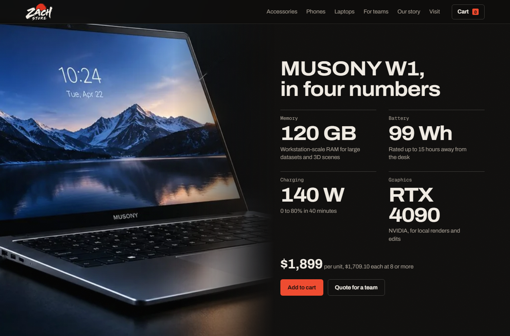
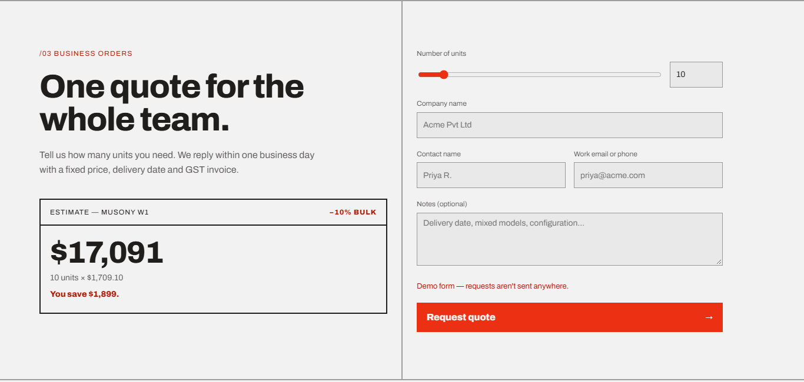
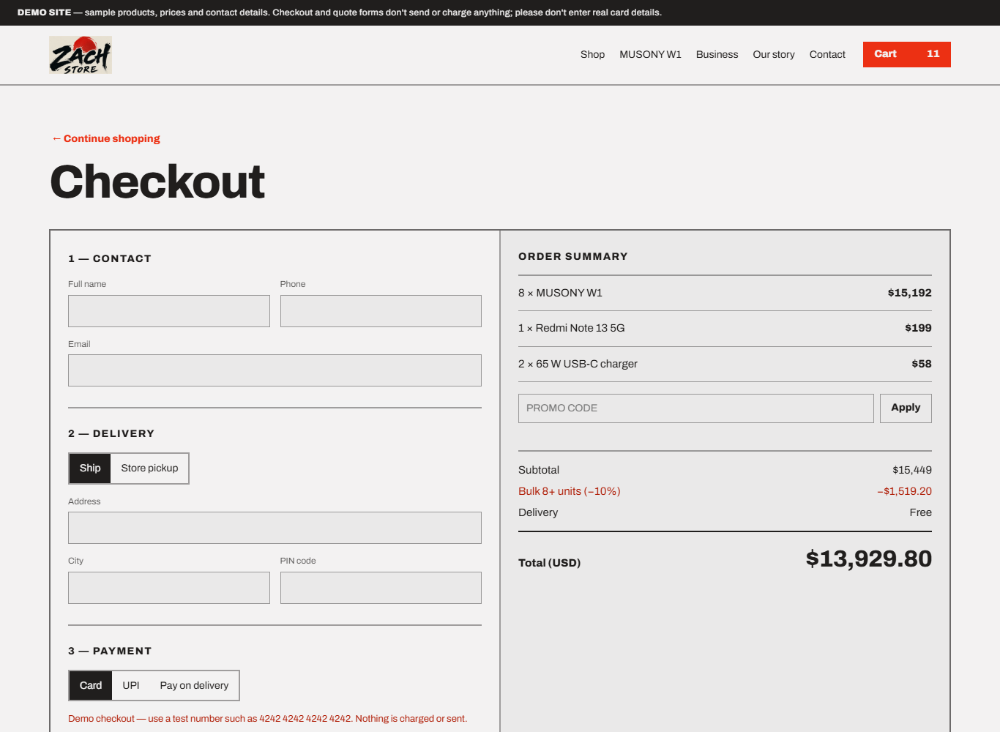
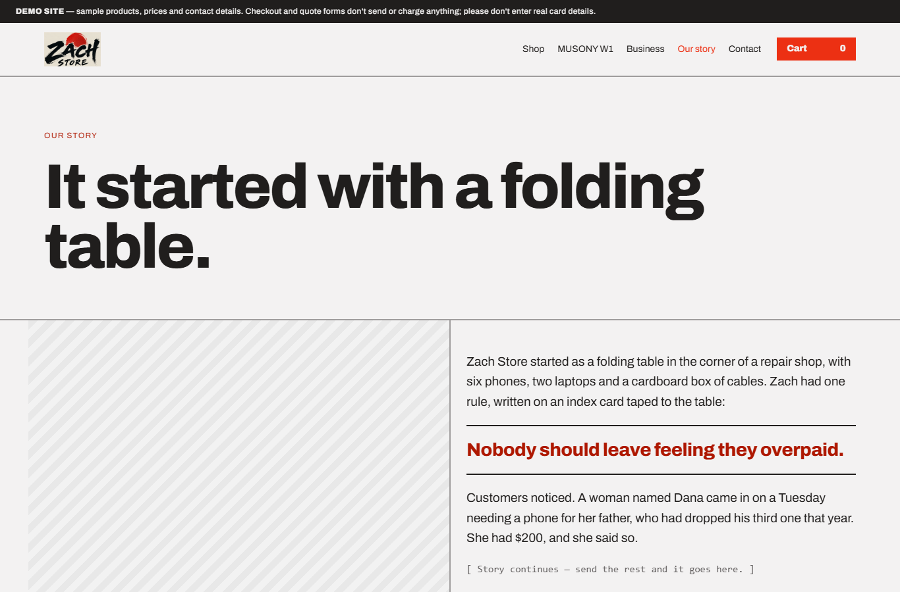
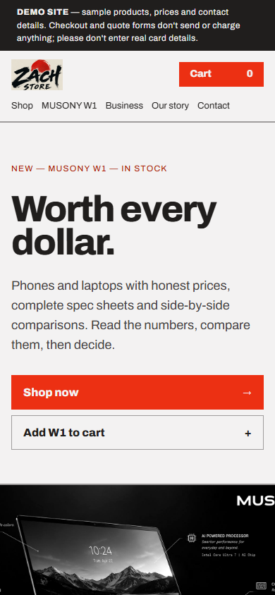
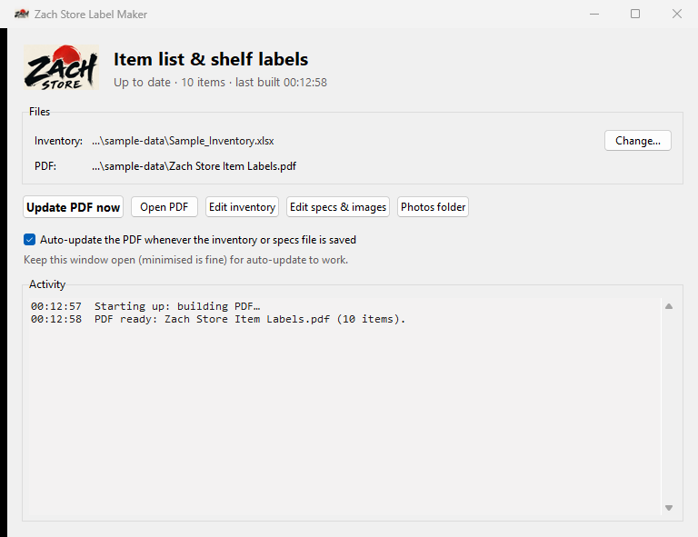
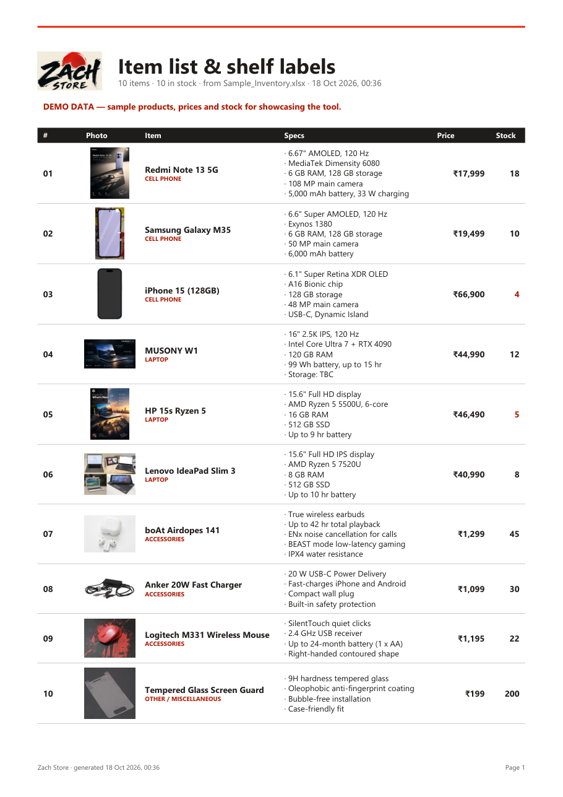
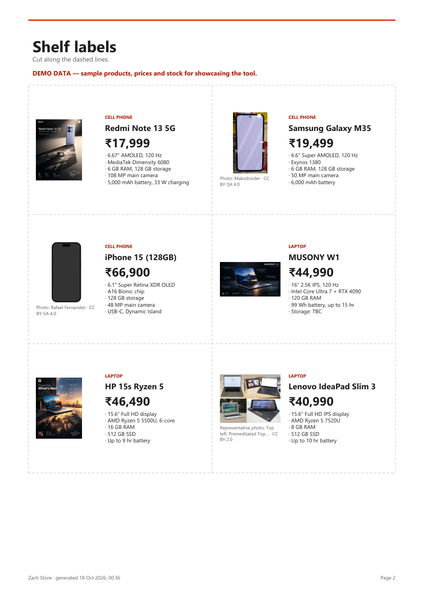

# Zach Store — retail toolkit for a small electronics shop

> **Demo setup.** Everything in this repository is a demonstration. The products, prices, stock levels, contact details and the "Zach Store" business data are samples. The website's checkout and quote forms don't send, store or charge anything. The Label Maker runs on a demo inventory with made-up costs and sales. No real customer or business data is included.

A phone and laptop shop was keeping its stock in an Excel sheet, rewriting price tags by hand, and had no proper web presence. This project gives the shop three connected pieces:

| | What it is | What it solves |
|---|---|---|
| **1. Storefront website** | A fast, mobile-friendly shop site, built from a Claude Design mockup | A branded online catalogue with transparent pricing, comparisons, a cart, checkout and business quotes |
| **2. Inventory tracker** | An Excel workbook (sample in [`sample-data/`](sample-data)) | One place for models, prices, sales and stock, with automatic profit and low-stock warnings |
| **3. Label Maker app** | A desktop app ([`Label Maker/`](Label%20Maker)) that reads the inventory | Print-ready item lists and shelf labels, with photos and specs, rebuilt automatically whenever stock changes |

The shop edits one spreadsheet, and the printed labels and item list stay up to date by themselves.

---

## 1 · Storefront website



**Features**
- **Shop grid with filters:** Phones, Laptops, Accessories, each with the key specs and a short "why it's good value" note.
- **Side-by-side compare** for 2–4 devices, with the lowest price highlighted.
- **Cart drawer** with quantity controls. The cart is kept between visits.
- **Discounts applied automatically:** 10% off any line of 8 or more units, plus a `WELCOME5` promo code.
- **Checkout** with ship or store-pickup and card, UPI or pay-on-delivery, plus input validation (PIN code, card, UPI ID).
- **Business quote** form with a live estimate as the unit slider moves.
- **"Our story" page,** a feature page for the shop's own laptop (MUSONY W1), and a footer with contact and policies.
- Responsive down to phone width, keyboard accessible, and respects reduced-motion settings.

| Shop & compare | Featured product | Business quote |
|---|---|---|
|  |  |  |

| Checkout (bulk discount applied) | Our story | Mobile |
|---|---|---|
|  |  |  |

**Tech:** plain HTML, CSS and JavaScript with no framework and no build step. The design-system tokens are in `modernist.css`, the layout in `styles.css`, and the product data and logic in `app.js`. Images were cut from about 9 MB to about 0.6 MB.

**Run it:** open `index.html`, or serve the folder:

```
python -m http.server 5173
```

> **Demo mode** (`DEMO_MODE = true` in `app.js`) shows a "DEMO SITE" banner and "nothing is sent" notes on the forms. Checkout and the quote form validate the input and show a confirmation, but send nothing. Going live needs a payment provider (such as Razorpay or Stripe) and a form or email backend.

---

## 2 · Inventory tracker (Excel)

`Model Name · Type · Purchase Price · Sell Price · Sale Count · Profit · Stock`

- A Type dropdown (Cell Phone, Laptop, Accessories, Other).
- Profit is calculated automatically, and totals are kept per column.
- Stock of 5 units or fewer is highlighted in red.
- New items go in the empty rows above TOTAL.

The repo includes **[`sample-data/Sample_Inventory.xlsx`](sample-data/Sample_Inventory.xlsx)**, which uses demo numbers only. The shop's real workbook is not in this repository.

---

## 3 · Label Maker (desktop app)



A small Windows app that starts from a desktop icon. It watches the inventory file and, a few seconds after each save, rebuilds **one PDF** with:

1. **An item list** showing photo, name, type, specs, price and stock, with low stock in red.
2. **Cut-out shelf labels** showing photo, name, price and key specs, with dashed cut lines.

| Item list | Shelf labels |
|---|---|
|  |  |

Full sample output: **[docs/sample-labels.pdf](docs/sample-labels.pdf)**

**How it works**
- It reads the inventory by column **headers** rather than fixed positions, so moving or adding columns doesn't break it.
- **Specs** live in an `Item Specs.xlsx` file next to the inventory. The app creates it, adds a row for each new item, and never changes the inventory itself.
- **Photos**, first match wins:
  1. The owner's own photo in `Label Maker/images`.
  2. An image link or path given in the specs sheet.
  3. The website's product photos.
  4. An exact product match on Wikipedia or Wikimedia Commons.
  5. A clearly labelled "representative photo".
  Matching rejects variants, so "iPhone 15" never picks up an "iPhone 15 Pro" photo. Downloads are cached, and the app slows down when Wikimedia asks it to.
- **Licence-aware:** each web photo carries its author and licence on the label, and the PDF ends with a full "Photo credits" page, as CC BY / BY-SA require.
- **Demo marker:** PDFs built from the sample inventory are stamped "DEMO DATA".
- **Reliability:**
  - It waits for a save to finish before reading the file.
  - It retries if the PDF is locked open in a viewer.
  - Only one copy can run at a time.
  - It keeps working offline using the photos it already saved.

**Tech:** Python 3 with `openpyxl`, `reportlab`, `Pillow` and `requests`, and a Tkinter window. Setup steps are in [`Label Maker/README.md`](Label%20Maker/README.md).

---

## Repository layout

```
index.html, app.js, styles.css, modernist.css   storefront website
assets/                                         logo + product photos (web-optimised)
Label Maker/                                    desktop app (label_maker.py core, app.pyw window, shortcut installer)
sample-data/Sample_Inventory.xlsx               demo inventory (fake numbers)
docs/                                           screenshots + sample PDF output
```

**Kept private (git-ignored):** the real inventory and specs workbooks, generated PDFs, app logs and settings, downloaded photo cache, the original design export, and local editor settings.

---

## Project timeline

1. **Design to website.** Rebuilt the Claude Design prototype as a standalone site with routing, a persistent cart, comparisons, checkout, promo and bulk pricing, and business quotes. Tested on desktop and mobile.
2. **Inventory tracker.** Made the shop's Excel tracker, with its profit formulas and low-stock flags, the single source of truth for everything else.
3. **Label Maker.** Built the PDF generator, web photo lookup, the specs companion sheet, the auto-updating desktop app and its Desktop shortcut. Tested auto-update end to end.
4. **Portfolio.** Added this write-up, screenshots and sample output, with real business data kept out of the repo.

---

## Security & privacy

- **No secrets in the repo.** There are no API keys, tokens or passwords; neither the site nor the app needs any. Web photo lookups use Wikipedia's public API without an account.
- **No real business data.** The real inventory, specs sheet, generated PDFs, app logs and settings are excluded by `.gitignore`. Only the demo workbook in `sample-data/` is published, and its file metadata has been cleared.
- **The website sends nothing.** There is no backend, analytics, cookies or tracking. The only third-party request is the Archivo font from Google Fonts. The cart lives in the visitor's own browser (`localStorage`). Card fields have autofill turned off and carry a "demo, don't enter real cards" notice, so a visitor's saved card is never offered on the demo.
- **The Label Maker stays local.** It reads and writes files on the shop PC only. Its only network calls fetch product photos from Wikipedia/Wikimedia, and downloaded images are checked and re-encoded before use.
- **Going live would need:** a payment provider's hosted checkout (so card data never touches this site), a form backend with spam protection, HTTPS (GitHub Pages provides it), and replacing all demo content.

## Copyright, licences & credits

- **This project's code and design:** © 2026 Zach Store project. All rights reserved. It is published to show the work. Viewing it is welcome, but copying, redistributing or reusing it needs written permission from the author. Ask about licensing or a similar build for your business.
- **Third-party material keeps its own licence:**
  - Wikimedia photos in the sample PDF are under CC BY-SA, CC BY, CC0 or public domain. Authors and licences are listed in **[docs/CREDITS.md](docs/CREDITS.md)** and on the PDF's "Photo credits" page.
  - The Archivo font is under the SIL Open Font License.
  - The Python libraries keep their own open-source licences.
- **Trademarks:** brand and product names are the property of their owners and are used only to describe sample products. No affiliation or endorsement is implied.
